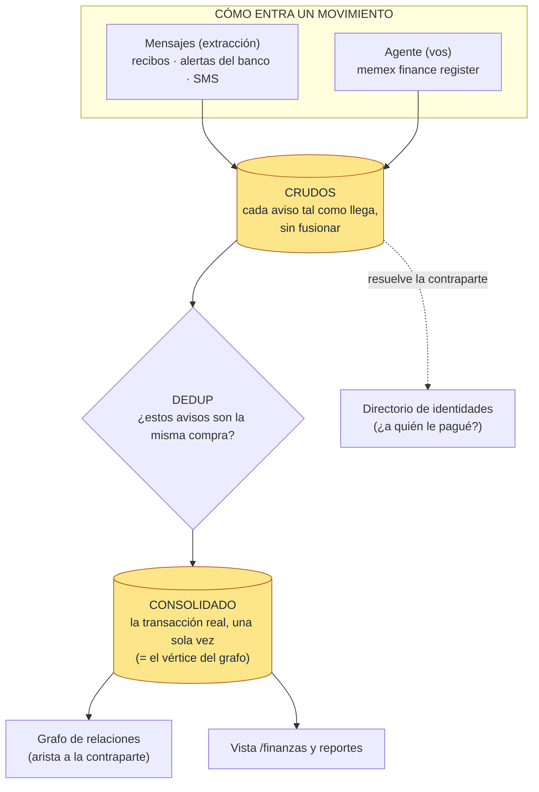
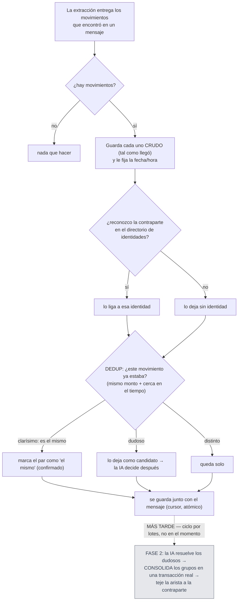

# Módulo finanzas — arquitectura

El **registro de movimientos de plata** de memex: extrae **ingresos y egresos** de tus correos y
chats (recibos, alertas del banco, SMS de la tarjeta) y los deja como un libro contable limpio.

Su problema central, en una frase: **el mismo pago llega varias veces** (el recibo por correo + la
alerta del banco + el SMS de la tarjeta). Si los contara todos, contaría una compra como tres. Por
eso su trabajo más fino es **deduplicar**: darse cuenta de que esos avisos son **la misma compra** y
dejar **una sola** transacción real.

La analogía: un contador que recibe el mismo gasto por tres canales y tiene que reconocer que es **un
solo** asiento, no tres.

## Arquitectura

**De un vistazo:** un movimiento entra por dos lados (mensajes o el agente). Cada aviso se guarda
**crudo** (tal como llegó, sin tocar). El **dedup** decide cuáles avisos son la misma compra, y la
**consolidación** los funde en **una** transacción real — ese consolidado es el dato canónico (lo que
ves en la vista) y el **nodo** del grafo. De paso, la contraparte ("a quién le pagué") se resuelve
contra el **directorio de identidades**.

## Responsabilidades

1. **Extraer movimientos de plata** — ingresos y egresos de correos y chats. Pide monto, moneda,
   categoría, contraparte y fecha, y **clasifica** cada movimiento en vez de omitirlo: `status`
   (¿la plata se movió? `completada` / `fallida` / `pendiente`) y `kind` (`pago` / `reembolso`).
   Publicidad y montos en cero no generan nada.
2. **Guardar cada aviso crudo** — sin fusionar; varios avisos del mismo gasto **coexisten**.
3. **Deduplicar** — reconocer cuándo varios avisos son la misma compra (mismo monto + cerca en el
   tiempo + misma contraparte). Lo clarísimo lo marca solo; lo dudoso lo deja para que la IA decida.
4. **Consolidar** — fundir cada grupo de duplicados en **una** transacción real (la "consolidada");
   es el dato que se lee y se reporta.
5. **Multimoneda** — comparar montos en distintas monedas (con tasas aproximadas) para el dedup;
   **nunca** fusiona automáticamente un cruce de monedas.
6. **Saber a quién le pagaste** — resuelve la contraparte (el texto "Uber") contra el directorio de
   identidades. Si dos movimientos tienen contrapartes **distintas**, no pueden ser el mismo.
7. **Alimentar el grafo** — la transacción consolidada es un nodo, conectado a su **contraparte**
   (identidad) y al **evento** que la originó.
8. **Vía del agente** — podés registrar una transacción directo (`memex finance register`), sin IA;
   por esa vía sí consolida y teje todo al instante.

## Cómo procesa un movimiento de la extracción

Cuando el orquestador procesa un mensaje, llama `finance.persist(...)` con los movimientos que el LLM
extrajo. **Importante:** por esta vía, `persist` solo **deja el movimiento en bruto, lo liga a su
contraparte y lo dedupea**. **Consolidar** (fundir duplicados) y **tejer las conexiones** pasa
**después**, en un ciclo por lotes — no en el momento.

En palabras:
1. **Guarda crudo** cada movimiento (tal como llegó) y le fija la mejor fecha/hora que tenga (si no
   hay fecha, usa cuándo llegó el mensaje).
2. **Liga la contraparte** a una identidad del directorio, si la reconoce (si no, la deja sin
   identidad).
3. **Dedupea** contra los movimientos cercanos: **clarísimo** → marca "es el mismo"; **dudoso** →
   candidato para la IA; **distinto** → queda solo.
4. **Guarda y cierra** — todo junto con el mensaje, en una sola transacción (si algo falla, se repite).
5. **Lo demás es después** — la IA desempata los dudosos, la **consolidación** funde los grupos en la
   transacción real y recién ahí se tejen las conexiones del grafo.

### Qué nunca se compara y qué pesa más

- **Mismo origen, nunca par.** Dos movimientos extraídos del mismo mensaje o documento son hechos
  distintos por construcción: un extracto no lista dos veces el mismo movimiento, y dos giros
  iguales en días seguidos son dos giros. Antes de esta regla (2026-09-12), 7 de 10 pares marcados
  sobre extractos reales eran filas del mismo extracto.
- **Fuentes independientes pesan más.** Si los dos movimientos los reportan observadores distintos
  (el extracto del banco y el correo del comercio; el aviso de la pasarela y el recibo de la
  tienda, que son correos de remitentes distintos), son dos sistemas viendo el mismo cobro: mismo
  monto + mismo día ya alcanza para ir al juez aunque la contraparte no coincida, y una contraparte
  distinta deja de vetar (el intermediario y el comercio se nombran distinto). Dos alertas del mismo
  banco o dos recibos del mismo comercio no son independientes: dos cafés iguales siguen siendo dos.
  El juez ve el tipo de fuente y el remitente de cada lado, más las descripciones.
- **Re-marcar lo ya cargado.** Estas reglas corren al insertar. Si cambian, `memex-finance remark
  [--dry-run]` recomputa los pares de todo lo cargado: quita los que la regla ya no produce (salvo
  los que decidió el juez), agrega los nuevos y deja la FASE 2 y la consolidación como pasos
  aparte (`memex-finance dedup`, `memex-finance consolidate`).
- **Automático.** El job `finance` del scheduler corre esos dos pasos cada
  `MEMEX_SCHEDULER_INTERVAL_FINANCE`. Se enciende desde el dashboard (`/procesamiento`, toggle del
  scheduler + job `finance`) o con `PATCH /processing/scheduler`; el env solo da el arranque y el
  intervalo. Encendido en la instalación del dueño desde 2026-09-12, cada 10 min. El juez va por
  codex: costo 0, ~2 pares por minuto.
- **Re-juzgar.** Si el juez se equivocó por una instrucción del prompt, se corrige el prompt y se
  re-juzga el par con `memex-finance dedup --pair <id>` (repetible); luego `consolidate`. No se
  toca la decisión a mano.

## Las vías de entrada

| Vía | En simple |
|---|---|
| **Mensajes (extracción)** | Automática. Solo guarda crudo + liga contraparte + dedupea. **Consolida después**, en el ciclo por lotes. |
| **Agente** (`memex finance register`) | Vos (o Hermes) registrás una transacción directo, sin IA. Acá **sí** consolida y teje las aristas **al instante**, en la misma operación. |
| **Cierre de evento multi-hecho** | Variante del agente: cuando una factura genera varios hechos, ata la contraparte **por id** a la identidad creada en el mismo evento (sin depender del match por nombre). |

## Precisiones (lo no obvio)

- **La extracción solo deja el movimiento en bruto.** Consolidar (fundir duplicados en la transacción
  real) y tejer las conexiones pasa **después**, en el ciclo por lotes — no al procesar el mensaje.
- **La vía del agente sí hace todo al instante** (consolida + teje en la misma operación).
- **Dos contrapartes distintas impiden la fusión** — aunque coincidan monto y hora, si sabemos que
  son personas/orgs distintas, no son el mismo movimiento.
- **Los cruces de moneda nunca se auto-confirman** — si los montos están en monedas distintas,
  siempre van a revisión (IA), nunca automático.
- **El monto se guarda tal cual** (sin convertir); la conversión solo se usa para **comparar** en el
  dedup.
- **Solo cuenta lo que se movió** (`status = completada`). Un cobro rechazado («payment failed») o
  una cuenta por pagar («saldo pendiente», factura emitida) se guardan con su estado para tener la
  traza (y para los asuntos, que siguen «Pagos Notion» por sus intentos fallidos), pero la API los
  excluye por defecto y el dashboard no los suma. Se pidió esto como **clasificación** y no como
  «ignorá los fallidos» porque el LLM, con la instrucción de omitir, igual los extraía como gasto.
- **Un reembolso no es un ingreso.** Devolución, nota crédito, reversión o contracargo entran como
  `direction = ingreso` + `kind = reembolso`: descuentan del gasto en su rubro y no inflan «lo que
  entró». El dedup nunca empareja naturalezas distintas: un cobro y su devolución, o un intento
  fallido y el cobro que después sí pasó, son dos hechos aunque compartan monto y contraparte.

---

## Rubros: «otros» solo cuando no se sabe

Los rubros son una lista cerrada: comida, transporte, software, servicios, educación, salud,
entretenimiento, **compras** (tiendas y productos físicos), **transferencia** (plata a o de
una persona), **traspaso** (entre cuentas propias: la recarga de la billetera desde el banco),
**ingreso** (pago recibido por trabajo o de una organización), **rendimientos** (intereses) y
otros. La guía de qué es cada uno (`rubros.CATEGORY_GUIDE`) la ven tanto el extractor como la
reclasificación, así clasifican igual. «Otros» es SOLO para cuando no se sabe qué es el
comercio ni el motivo (decisión del dueño, 2026-09-16); antes era el rubro más grande porque
la lista era solo de gastos.

**Regla por contraparte.** Cuando el extracto trae solo el nombre («COMPRA EN NACANISAJE
SAS»), nadie puede adivinar qué es; el dueño sí lo sabe. `memex finance rubro --counterparty
"Nacanisaje SAS" --category comida` guarda la regla (`mod_finance_counterparty_rules`, llave
= contraparte normalizada con `memex_norm`) y la aplica a TODO lo de esa contraparte, pasado y
futuro: al insertar (extracción y `register`), al consolidar y hacia atrás. En la vista
`/finanzas` el cuadrito de color de cada fila es un selector: elegir un rubro ahí es lo mismo.
Por Telegram alcanza con decirlo. La regla del dueño (`source=user`) pisa la del modelo
(`llm`), nunca al revés.

**Reclasificación** (`memex finance recategorize [--dry-run]`, mantenimiento): relee lo que
está en «otros» agrupado por contraparte (o por descripción sin montos cuando no hay
contraparte: «Envío con Bre-B»), resuelve determinista lo obvio (recarga desde el propio
banco = traspaso, intereses = rendimientos) y le pregunta al modelo el resto en lotes de 60
(consumer `finance_categorize`, DeepSeek). Lo que decide con confianza ≥ 0,6 queda como regla
`llm` y se aplica; lo que no reconoce sigue en «otros», que es lo correcto.

## Suscripciones (qué se renueva y cuándo)

Una **suscripción** no es una transacción: es la REGLA que las genera (proveedor + cadencia + monto
típico + estado). Vive en finanzas, en `mod_finance_subscriptions`, y sus cargos quedan como
evidencia en `mod_finance_subscription_charges` (un cargo pertenece a lo sumo a UNA, así no se
cuenta dos veces).

**Cómo se deducen** (`subscriptions.py`, determinista, sin LLM): agrupa los egresos consolidados
`completada`+`pago` por proveedor (la identidad del directorio si la hay, si no el nombre
normalizado) y moneda, y busca una cadencia. Lo que enseñaron los cargos reales:

- **El indicio fuerte es el DÍA DEL MES, no el monto.** Hay suscripciones que facturan por uso y
  cobran de 5 a 37 USD siempre el día 1; y recargas de saldo con el importe idéntico en fechas
  sueltas. Una regla tipo «mismo monto cada mes» falla en los dos sentidos.
- Para llamarlo mensual se exige que encaje la mayoría de los **meses** y la mayoría de los
  **cargos**: sin lo segundo, unas compras que por azar rozan el mismo día pasarían por suscripción.
- Las cadencias cortas (semanal/quincenal) piden 4 cargos: con dos, un solo intervalo no es un
  ritmo (dos cuotas de una matrícula separadas 6 días no son una suscripción semanal).
- La ingesta tiene huecos, así que faltar meses **baja la confianza**, no descalifica.

Por eso el detector **propone** con `confidence` y el usuario decide: `pinned` (lo que corrigió no
se pisa) y `status='descartada'` (no era una suscripción; deja de proponerse). `sin_cobros` marca
las que llevan más de dos periodos sin cargo: probablemente canceladas.

`recurrence` guarda la regla en líneas RFC 5545 y se expande con el motor del calendario
(`modules/calendar/recurrence.py`, puro): «cada mes el día 1» significa lo mismo en agenda y en
finanzas. `next_renewal_on` se materializa porque es lo que se lee y por lo que se avisa.

| Vía | Comando |
|---|---|
| Ver qué se renueva y cuándo | `memex-finance subs [--all] [--json]` |
| Releer los cargos y proponer | `memex-finance subs-detect` |
| Cancelar / descartar a mano | `memex-finance subs-set --id N --status cancelada\|descartada` |

El aviso previo lo da el productor `renovaciones` del daemon de notificaciones
(`dias_anticipacion=3` por default). `monthly_commitment()` suma el costo mensual **por moneda**:
no convierte USD a COP, porque una tasa aproximada daría un número que parece exacto y no lo es.

## La vista `/finanzas`

El **periodo manda**. Arriba se elige un mes (con flechas) o una ventana de 3, 6 o 12 meses, o todo;
de ahí cuelgan el resumen, las categorías y la lista. Todo el recorte ocurre en el cliente sobre un
único fetch de `/finance/transactions` (~1.600 movimientos), así que cambiar de mes es instantáneo.
El periodo y los filtros viven en la URL (`?p=6m&m=2026-07&cat=transporte&q=uber&dir=egreso&cur=USD`),
así una vista sobrevive al reload y se puede compartir.

- **Cabecera**: cuánto SALIÓ en el periodo (la cifra que uno viene a ver), con cuántos movimientos,
  qué entró y el balance. En el mes en curso, además, el **ritmo**: «día 14 de 30, a esta altura del
  mes solías llevar $778.285: vas 64% por encima», comparando contra el mismo día de los tres meses
  anteriores. Sin eso, un mes a mitad de camino siempre parece barato.
- **Tira de meses**: doce columnas con dos barras finas (salió / entró) que además ES el navegador —
  al hacer clic, el periodo salta a ese mes— y resalta los meses que entran en la cifra grande.
- **En qué se fue**: las categorías como barras de datos dentro de la fila, de mayor a menor, con su
  cuenta y su porcentaje. La fila entera es un filtro de la lista de al lado.
- **Se repite**: las suscripciones detectadas (`GET /finance/subscriptions`) con el compromiso
  mensual por moneda y la próxima renovación.
- **Movimientos**: agrupados por día como el extracto de un banco, o en lista plana al ordenar por
  monto. Filtros de sentido, categoría, texto y «incluir lo que no se movió»; al tocar una
  contraparte, la lista se queda con ella.

**Un mes sin extracto no es un mes barato.** Los meses con el PDF del banco traen decenas de
movimientos; los que solo tienen los avisos que llegaron por correo traen un puñado, y la cifra se
lee como si fuera el gasto real. Cada movimiento dice ahora si vino de un documento subido
(`from_document`), la vista avisa qué meses cerrados no tienen extracto («falta el extracto de
agosto: de ese mes solo están los cobros que llegaron por correo»), no compara el mes en curso
—cuyo extracto el banco todavía no emitió— contra meses que sí lo tienen, y el botón **Subir
extracto** lo carga ahí mismo (`POST /documentos`: se lee, se extraen los movimientos y se
deduplican contra los que ya estaban, así un cobro que llegó por correo y aparece en el extracto
queda como uno solo).

Reglas de presentación del dinero (`lib/money.ts`, `lib/finance-period.ts`):

- los decimales los decide la **moneda**: en pesos no hay centavos (ni sumando un periodo entero),
  en dólares solo si el monto los trae; una cripto que Intl no conoce se escribe «5 USDT»;
- el **gasto va en tinta normal**, no en rojo: son el 90 % de las filas y una lista toda roja no se
  lee. Verde solo lo que entró, azul lo devuelto, tachado y apagado lo que no se movió;
- un **reembolso descuenta** del gasto y no cuenta como ingreso; lo fallido o pendiente se ve pero
  no suma; **nunca se suman monedas distintas** (no hay tipo de cambio).

Los ids de los movimientos, el texto original del que salió cada uno y la actividad del módulo viven
detrás del interruptor **Inspección** (compartido con `/asuntos`).

## Apéndice técnico

Para quien mantiene el código. Vive en `src/memex/modules/finance/`. Es un `InterestModule` (consume
`EMAIL`+`CHAT`, excluye `SOCIAL`); calca el patrón de calendar (cruda → dedup FASE 1 procedimental →
FASE 2 LLM → consolidación).

### Equivalencias con el diagrama

| En el diagrama | En el código |
|---|---|
| Guardar crudo | `FinanceModule.persist` → `dedup` → `_insert_transactions` (`module.py`); `mod_finance_transactions` (append-only, sin UNIQUE; `identity_fields=()`) |
| Ligar contraparte | `_resolve_identity` vía `ctx.deps['identidades']` (`optional_deps`, dependencia blanda); FK `counterparty_identity_id` |
| Dedup (¿es el mismo?) | `dedup.py`: `mark_duplicates` → `_gate` (monto+proximidad) + `_evaluate_pair` (score) → 3 bandas; `mod_finance_dedup_candidates` |
| Veto por contraparte distinta | `_same_responsible` — ids distintas → `_evaluate_pair` devuelve `None` y veta el par |
| Multimoneda | `fx.py` (`DEFAULT_RATES`, tolerancia `0.12`); un cruce de monedas nunca cumple `_both_timed` → nunca auto-confirma |
| Consolidar → transacción real | `consolidate.py`: `build_groups` (union-find) + `pick_winner`/`merge_fields`; `mod_finance_consolidated` (el vértice) + `mod_finance_transaction_links` (N:1) |
| La IA desempata dudosos | `dedup_llm.run_finance_dedup_phase2` (FASE 2), en el ciclo |
| Aristas del grafo | `weave_finance_consolidated` (`relations/deterministic.py`): «contraparte» (finance→identidad) + «mismo_evento» (por `event_id`) |
| Ciclo por lotes | `run_finance_cycle` = dedup FASE 2 (LLM) → `run_consolidation` (`scheduler/jobs.py`) |
| Vía agente (inline) | `finance.register` / `memex finance register` (`cli.py`): insert + dedup + `ensure_consolidated` + weave en la misma tx |
| Cursor | lo escribe el **orquestador** (`_insert_cursor`) en la misma tx que `persist` |

### Qué guarda (tablas)

Migración **0036** (v2, reemplazó el viejo `mod_finance_expenses` solo-gastos); **0040** agregó
`event_id`; **0090** agregó `status` y `kind` (crudas y consolidadas).

- **`mod_finance_transactions`** — los movimientos **crudos** (append-only, **sin UNIQUE**).
  `direction` (ingreso/egreso), `status` (completada/fallida/pendiente), `kind` (pago/reembolso),
  `amount`/`currency`, `category`, `counterparty` + `counterparty_identity_id`, `occurred_at` +
  precisión (`datetime`/`date`/`inferred`), `processing_outcome`, `event_id` (solo por la vía
  agente).
- **`mod_finance_dedup_candidates`** — los pares "quizás iguales" (`a<b`, `score`, `status`
  candidate/confirmed/rejected, `decided_by` procedural/llm).
- **`mod_finance_consolidated`** — la **transacción real** (el vértice del grafo); `winner_transaction_id`,
  `deleted` (tombstone), `status`/`kind` heredados del ganador. **El front lee de aquí**
  (`GET /finance/transactions`, que por defecto devuelve solo `status=completada`; `status=all|
  fallida|pendiente` y `kind=` para el resto).
- **`mod_finance_transaction_links`** — qué crudas pertenecen a cada consolidado (N:1).

Costura: `counterparty_identity_id → mod_identidades(id) ON DELETE SET NULL`.

### Archivos clave

| Archivo | Rol |
|---|---|
| `module.py` | `FinanceModule`: contrato, `persist`→`dedup` (insert cruda + ligar identidad + dedup FASE 1), superficie de lectura, y `register` (vía agente: insert + dedup + consolida + teje inline). |
| `schema.py` · `prompt.py` | `TransactionItem` (contrato de extracción) y los prompts (extracción + dedup FASE 2). |
| `dedup.py` | FASE 1 pura: `_gate`, `_same_responsible` (veto de identidad), `_evaluate_pair` (score), `mark_duplicates` (3 bandas). |
| `fx.py` | Multimoneda: tasas, tolerancia, `convert`/`approx_equal`. |
| `consolidate.py` | Union-find → ganador → `mod_finance_consolidated` + links; `run_consolidation` (lote) y `ensure_consolidated` (inline). |
| `dedup_llm.py` | FASE 2: desambigua con LLM los pares "candidate". |
| `cli.py` | `memex-finance`: `register` (agente, sin LLM) / `dedup` / `consolidate`; `register_from_args` (reusado por el cierre de evento). |
| `relations/deterministic.py` · `relations/vertices.py` | Tejido de aristas (contraparte/mismo_evento) y proyección del vértice `finance`. |
| `scheduler/jobs.py` · `agent_event.py` | `run_finance_cycle` (lote) y el cierre de evento (ata contraparte por id). |
| `migrations/0036`, `0040` | Schema v2 (4 tablas) + `event_id`. |
